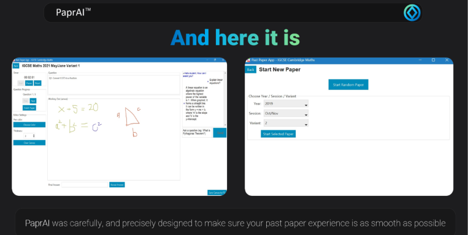
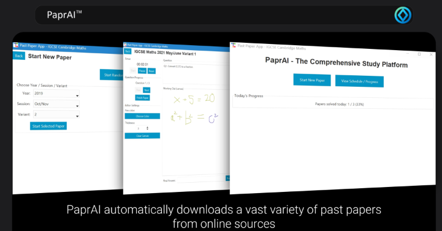
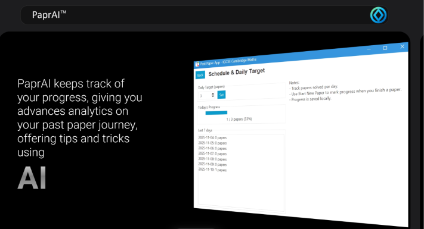
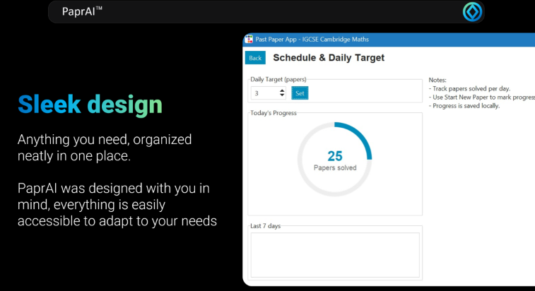

<h1 align="center">PaprAI</h1>
<h3 align="center">Rewriting Revision.</h3>

*(Prototype App developed for the MRIS Hackathon 2025, theme 'AI and Education',and won 1st place).*

PaprAI is a comprehensive study app that simplifies and streamlines the past-paper workflow.
Features:

- Automatic downloading of papers by subject/year/variant OR random paper (In the future: integrate with real past papers and questions from them)
Sidebar: 
- Timer to track time as youre solving, with pause/reset
- Question progression for quick navigation, and FINISH paper (mark as completed)
- Editor settings for pen color and thickness

- Other sidebar: AI Helper Panel to guide through questions and give hints/help (in the future: use OCR to mark the working out to check where mistake is)

Main window:
- Current question
- Working out space (drawable), can be saved to disk
- Enter answer and reveal correct answer

- tracks paper completion to prevent doing same ones again 
- Allows you to set daily completion target for papers
- In the future: set up preparation schedule for week/month with notifications

DISCLAIMER: This application is not a real fully functioning app, but rather a proof of concept prototype created for a hackathon.

Developed by [HNTech](https://www.github.com/hntechsoftware) alongside Wali.
Future plan: To develop an ipadOS & Android Tab app based off this prototype, as Windows is not the most suitable device to be solving papers on!
